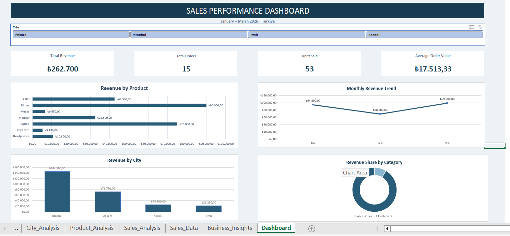

# Sales Data Analysis | Microsoft Excel

## Project Overview

An end-to-end sales data analysis project using Microsoft Excel to transform raw sales data into actionable business insights through data cleaning, analysis, visualization, and interactive dashboard development.

## Business Objectives

- Evaluate overall sales performance.
- Identify top-performing products and cities.
- Analyze monthly revenue trends.
- Compare product category performance.
- Develop data-driven business recommendations.

## Dataset Overview

| Attribute | Details |
|---|---|
| Analysis Period | January – March 2026 |
| Country | Türkiye |
| Total Orders | 15 |
| Products | 7 |
| Categories | 2 |
| Cities | 4 |
| Dataset Type | Synthetic |

The dataset was created for educational and portfolio purposes.

## Tools & Skills

- Microsoft Excel
- Data Cleaning and Validation
- Exploratory Data Analysis (EDA)
- Excel Formulas and Functions
- PivotTables and PivotCharts
- KPI Analysis
- Data Visualization
- Interactive Dashboards
- Slicers and Dynamic Filtering
- Business Reporting
- Analytical Thinking
- Problem Solving

## Project Workflow

1. Understanding the dataset
2. Data preparation
3. Data exploration
4. Data cleaning
5. Sales performance analysis
6. Data visualization
7. Interactive dashboard development
8. Business insights and recommendations
9. Data validation and quality assurance

## Key Performance Indicators

| KPI | Result |
|---|---:|
| Total Revenue | ₺262,700 |
| Total Orders | 15 |
| Units Sold | 53 |
| Average Order Value | ₺17,513.33 |

## Interactive Sales Dashboard

The dashboard provides an interactive overview of sales performance, including product revenue, monthly trends, city performance, and category revenue distribution.

### Dynamic City Filtering

The City Slicer allows users to explore sales performance by selecting individual or multiple cities.

## Key Business Insights

- Phone generated the highest revenue at ₺90,000.
- Mouse was the best-selling product by quantity, with 19 units sold.
- Phone and Laptop accounted for approximately 62.81% of total revenue.
- Istanbul contributed 55.16% of total revenue.
- Electronics generated 91.36% of total revenue despite having fewer units sold than Accessories.
- Revenue decreased by 27.64% in February and recovered by 44.75% in March.

## Business Recommendations

- Review inventory levels for high-revenue products.
- Test targeted marketing campaigns.
- Explore cross-selling opportunities by combining electronics with accessories.
- Evaluate growth opportunities in Izmir and Kocaeli.
- Investigate the February revenue decline.
- Collect product cost data to evaluate profitability and profit margins.

## Technical Challenges & Solutions

During dashboard development, a Slicer persistence issue was identified. Troubleshooting, workbook inspection, and internal file corrections were used to resolve the issue. The dashboard was subsequently tested to verify filtering functionality and successful saving.

## Data Limitations

- The dataset contains only 15 orders.
- The analysis covers a three-month period.
- Product costs and operating expenses are unavailable.
- The dataset is fictional and does not represent an actual business.

## Project Files

- [Excel Workbook](Sales_Data_Analysis_Fixed.xlsx)
-  Dashboard screenshots
- Business insights and recommendations

For the full interactive experience, download the Excel workbook and open it in Microsoft Excel.

## Conclusion

This project demonstrates a complete Excel-based data analysis workflow, from raw data preparation to interactive reporting and business decision support.

It highlights the importance of data accuracy, analytical thinking, visualization, problem-solving, and translating numerical findings into meaningful business recommendations.

## Author

**Busra Cuma**

Computer Engineer | Aspiring Data Analyst

Passionate about transforming data into meaningful insights and supporting data-driven decision-making.
